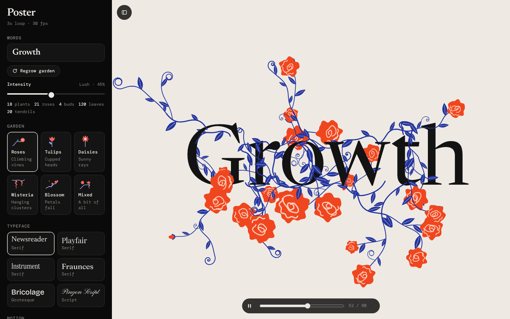
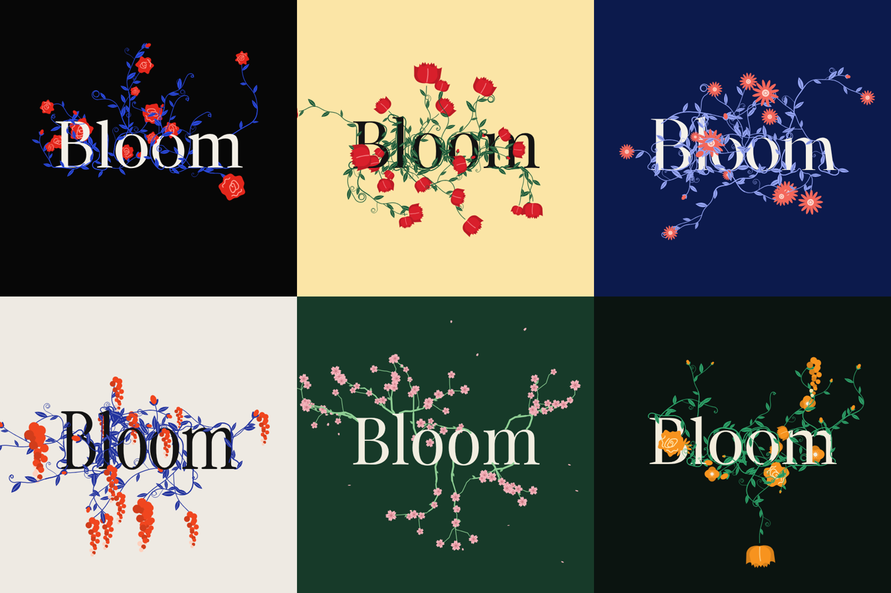

<p align="center">
  
</p>

<h1 align="center">BloomType <sub>by Jericho</sub></h1>

<p align="center">
  Type a word. A garden grows around it.<br>
  Vines climb the letters, flowers open, and the whole poster loops — ready for a reel or your website.
</p>

<p align="center">
  <a href="https://msreeganeshnaik.github.io/BloomType/"><b>Open BloomType</b></a>
</p>

<p align="center">
  
</p>

## Try it

Open **[msreeganeshnaik.github.io/BloomType](https://msreeganeshnaik.github.io/BloomType/)**. It runs in your browser: no install, no account, no upload.

## How it works

| You | BloomType |
|---|---|
| Type a word | Vines sprout from each letter's own outline, climb it like ivy and weave over and under its strokes |
| Pick a garden | Roses, tulips, daisies, wisteria, blossom, or a mix of all of them |
| Drag **Intensity** | The garden fills in from a few sprigs to overgrown, live, as you drag |
| Press **Regrow garden** | A new random garden at the same intensity, every time |
| Pick a motion, typeface and palette | The poster changes instantly and keeps looping |
| Export | A seamless MP4, every frame as PNG, a still, an HTML page or embed code for your site |

<p align="center">
  
</p>

## Gardens

<p align="center">
  
</p>

| Garden | What grows |
|---|---|
| **Roses** | Climbing vines with swirl roses, buds and corkscrew tendrils |
| **Tulips** | The same climbing vines, crowned with cupped tulips that face along the stem |
| **Daisies** | Climbing vines with open daisies |
| **Wisteria** | Climbing vines with flower clusters that hang and swing |
| **Blossom** | Angular branches with clusters of five-petal blossom, and petals that fall in every motion |
| **Mixed** | Roses, tulips, daisies, poppies and wisteria together |

## Motions

| Motion | What happens | Loop |
|---|---|---|
| **Static** | A still poster | — |
| **Breathe** | Stems sway and flowers breathe | 3s |
| **Grow & wither** | The garden grows in, blooms, then pulls back | 6s |
| **Typed** | The word types itself out, is cut, and starts again | 5s |
| **Gust** | A gust sweeps across and petals fly | 4s |
| **Reach** | Stems lean toward a moving light; in the editor it follows your cursor | 6s |
| **Scatter** | Flowers bloom and fade at random | 6s |
| **Visitor** | A butterfly flies in, rests on a flower and flies off | 7s |

Every loop is seamless: the last frame flows straight into the first.

**Typefaces:** Newsreader, Playfair Display, Instrument Serif, Fraunces, Bricolage Grotesque and Pinyon Script. Switching typeface re-grows the garden from the new letter shapes.

**Palettes:** Rose noir, Paper, Midnight, Citrus, Orchid, Moss, Tomato and Butter.

## Export

| Format | What you get |
|---|---|
| **MP4** | H.264 at 30 fps, one seamless loop, rendered frame by frame |
| **PNG frames** | Every frame of the loop, zipped |
| **Still PNG** | The frame on screen |
| **HTML file** | A standalone page that draws the poster live, sharp at any size |
| **Embed code** | An HTML snippet or a React component for your own site |

Pick the ratio when you export: **Full** (exactly what you see), **1:1**, **4:5**, **9:16** or **16:9**. Each ratio re-composes the poster for its frame, so nothing is ever cropped. Turn on **Transparent background** to lay a PNG, HTML page or embed over your own design.

### Put it on your website

Open **Export → Embed code**, choose **HTML** or **React**, and press **Copy code**.

- **Webflow, Framer, WordPress or plain HTML:** paste the snippet into an embed or custom HTML block. It scales to its box, pauses when it scrolls off screen, and holds a still frame for visitors who prefer reduced motion.
- **React or Next.js:** save it as `BloomTypePoster.jsx` and render it:

```jsx
import BloomTypePoster from "./BloomTypePoster";

export default function Hero() {
  return <BloomTypePoster style={{ maxWidth: 960, margin: "0 auto" }} />;
}
```

The snippet is self-contained (about 40 KB) and only fetches its typeface from Google Fonts.

## Private by design

BloomType has no server, no account and no analytics. Your word is drawn in your browser and never leaves it. The only outside requests are Google Fonts for the typefaces and, when you export a video or a zip, two small libraries from jsDelivr.

## Shortcuts

| Key | Does |
|---|---|
| <kbd>Space</kbd> | Play or pause |
| <kbd>R</kbd> | Regrow the garden |
| <kbd>\\</kbd> | Hide or show the panel |

## Build from source

```bash
git clone https://github.com/MSreeGaneshNaik/BloomType.git
cd BloomType
npx serve .            # or just open index.html in a browser
```

There is no build step and no framework — one HTML file, about 1,300 lines.

| File | What it does |
|---|---|
| [`index.html`](index.html) | The whole app. `<script id="bloom-engine">` is the engine: letter outlines as distance fields, climbing growth, the flowers, the motions and the renderer. The script after it is the editor: the panel, the live preview and every export. The engine is also what the HTML file and embed code ship. |
| [`assets/`](assets) | The icon and the images in this README |
| [`.nojekyll`](.nojekyll) | Tells GitHub Pages to serve the files as they are |

## Good to know

- Words can be up to 16 characters. Emoji are not allowed.
- Your last word, garden and settings are remembered in your browser.
- MP4 export needs WebCodecs (current Chrome, Edge, Safari and Firefox). Browsers without it record a WebM instead.
- Lighthouse, measured locally: Performance 95+ on mobile and 100 on desktop; Accessibility, Best Practices and SEO 100.
- Hosted on GitHub Pages from the `main` branch.

## Credits

BloomType is made by Jericho, and the petal mark is Jericho's. The idea of flowers growing around typed words was inspired by Type Garden. BloomType is an independent, from-scratch implementation; no code from Type Garden was used. Typefaces come from Google Fonts, and the MP4 and zip exports use mp4-muxer and fflate (both MIT).
