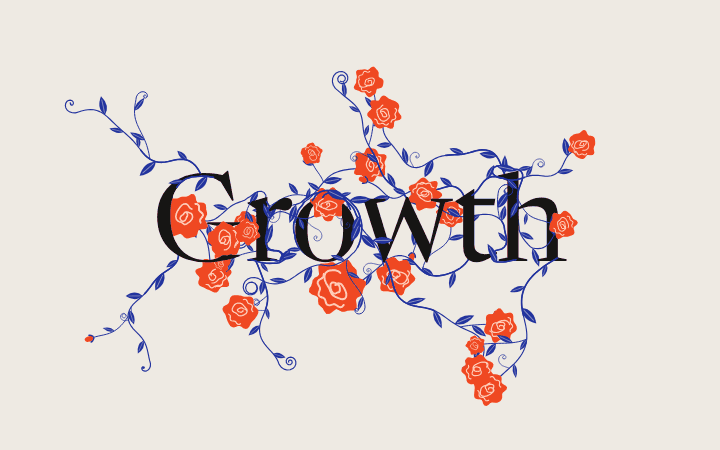
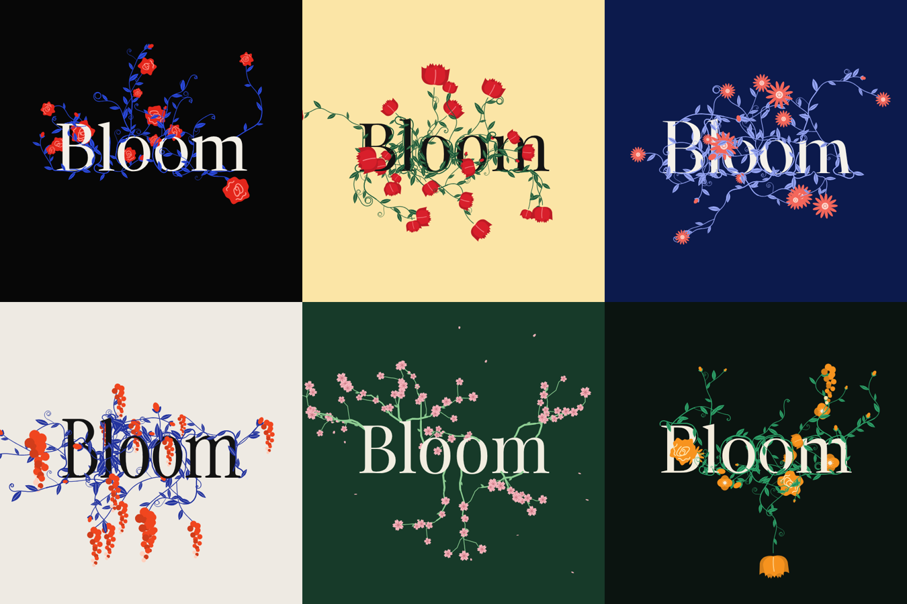

<p align="center">
  
</p>

# BloomType

Type a word. A garden grows around it.

**[Open BloomType](https://msreeganeshnaik.github.io/BloomType/)**

BloomType turns any word into a living poster. Vines climb the letterforms, roses open, petals fall. Pick a garden, a typeface, a motion and a palette, then export a seamless loop for social, or drop the poster straight into a website as code.


## Gardens



| Garden | What grows |
| --- | --- |
| **Roses** | Ivy that climbs each letter's outline and weaves over and under its strokes, with swirl roses, buds and corkscrew tendrils |
| **Tulips** | The same climbing vines, crowned with cupped tulips facing along the stem |
| **Daisies** | Climbing vines with open daisies |
| **Wisteria** | Climbing vines with flower clusters that hang and swing |
| **Blossom** | Angular branches with clusters of five-petal blossom; petals drift down in every motion |
| **Mixed** | Roses, tulips, daisies, poppies and wisteria in one garden |

## Controls

- **Words**: up to 16 characters. Click the poster to type straight onto it.
- **Regrow garden** (`R`): a new random layout every time.
- **Intensity**: how full the garden is, from a few sprigs to overgrown. Regrow stays random but lands near the level you set.
- **Typeface**: Newsreader, Playfair Display, Instrument Serif, Fraunces, Bricolage Grotesque, Pinyon Script. Switching face re-sprouts the garden from the new letter shapes.
- **Motion**: Static, Breathe (3s), Grow & wither (6s), Typed (5s), Gust (4s), Reach (6s, stems follow your cursor in the editor), Scatter (6s), Visitor (7s).
- **Palette**: Rose noir, Paper, Midnight, Citrus, Orchid, Moss, Tomato, Butter.
- **Shortcuts**: `Space` play or pause, `R` regrow, `\` hide the panel.

## Export

| Format | What you get |
| --- | --- |
| **MP4** | H.264 at 30 fps, one seamless loop, encoded frame by frame in the browser |
| **PNG frames** | Every frame of the loop, zipped |
| **Still PNG** | The frame on screen |
| **HTML file** | A standalone page that draws the poster live at any size |
| **Embed code** | An HTML snippet or a React component for your own site |

Ratios: **Full** (exactly what you see), **1:1**, **4:5**, **9:16** and **16:9**. Each ratio recomposes the poster for its frame, so nothing gets cropped. The transparent-background switch applies to PNG, HTML and embed exports.

MP4 export uses WebCodecs (current Chrome, Edge and Safari). Browsers without it record a WebM instead.

### Put it on a website

Open **Export → Embed code**, choose **HTML** or **React**, and copy.

- **Webflow, Framer, WordPress or plain HTML**: paste the HTML snippet into an embed or custom HTML block. It scales to its box, pauses when scrolled off screen and holds a still frame for visitors who prefer reduced motion.
- **React or Next.js**: save the code as `BloomTypePoster.jsx`, then render it:

```jsx
import BloomTypePoster from "./BloomTypePoster";

export default function Hero() {
  return <BloomTypePoster style={{ maxWidth: 960, margin: "0 auto" }} />;
}
```

The snippet is self-contained (about 40 KB) and only loads its typeface from Google Fonts.

## How it works

- The poster is a pure function of word, seed, garden, typeface, palette, motion, frame size and time. Every moving part is periodic in the loop, so exports loop with no seam.
- Each glyph is rasterised into a signed distance field. Stems follow the letter's outline at a small offset, peel away, then curl. A stem switches layer every time it enters a stroke, which gives the over-and-under weave.
- Plants are seeded per letter, so typing a new letter grows only that letter's garden.
- Exports render offline, frame by frame, never in real time: [WebCodecs](https://developer.mozilla.org/docs/Web/API/WebCodecs_API) with [mp4-muxer](https://github.com/Vanilagy/mp4-muxer) for video, [fflate](https://github.com/101arrowz/fflate) for zips. Both load only when you export.
- One HTML file. No build step, no framework.

## Run it locally

Open `index.html` in a browser, or serve the folder:

```sh
npx serve .
```

## Hosting

The site is served by GitHub Pages from the `main` branch root (**Settings → Pages → Deploy from a branch → `main` / root**). `.nojekyll` keeps Pages from processing the files.

## Credits

Inspired by a reel of [type-garden.vercel.app](https://type-garden.vercel.app). BloomType is an independent rebuild written from scratch from the video; no code from the original was used.

Typefaces from [Google Fonts](https://fonts.google.com). Export libraries mp4-muxer and fflate (both MIT) load from jsDelivr.
